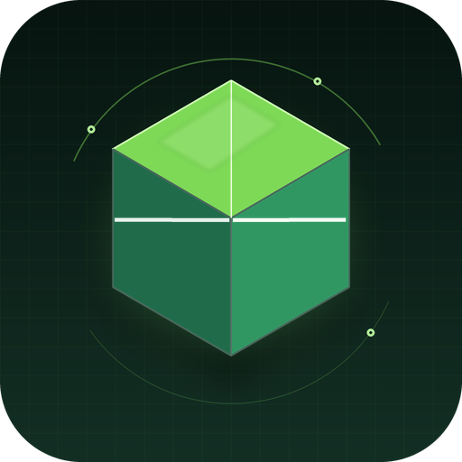

# OmniCube



**OmniCube** is an all-in-one, client-side Fabric toolkit for **Minecraft 1.21.11**.

**Repository:** [sjgamer92og-spec/omnicube](https://github.com/sjgamer92og-spec/omnicube)

**Current release:** `0.2.0+1.21.11`


It brings a configurable HUD, useful quality-of-life modules, waypoints, macros, chat logging, better tooltips, free look, client-side name tags, world markers and inventory tools together in one clean, toggleable mod. Every feature can be switched off, and every setting is adjustable in-game — no config-file editing required (although `config/omnicube.json` is human-readable if you prefer).

**v0.2.0** adds the five roadmap features below and fixes HUD/config/screen issues found during the full audit. See the [roadmap](#what-is-not-in-v020-roadmap) for what remains intentionally out of scope.

The name reflects the goal: one compact cube of client-side utilities covering many parts of the game. It is not affiliated with, endorsed by, or derived from Cactus Mod.

## Feature highlights

### HUD (draggable, toggleable)

Open the **HUD Editor** (`H` by default, or `/omnicube hud`) to drag elements anywhere or right-click them to show/hide. Positions are stored as screen fractions, so they survive resolution and GUI-scale changes.

- FPS and frame time
- Coordinates and chunk coordinates
- Biome and dimension
- Facing direction and yaw
- Server ping
- Movement speed
- Nearby entity count
- Server address
- Java memory usage
- Session playtime
- Real clock and in-game time
- Stopwatch timer
- Nearest primed TNT fuse
- Waypoint compass (direction + distance)
- Active potion effects and durations
- Armor durability
- Experience level and progress
- Held-item durability
- WASD/space/shift keystrokes
- Left/right CPS

### Modules

| Category | Feature | What it does |
| --- | --- | --- |
| Render | Fullbright | Raises gamma with a configurable brightness and restores your exact original value when disabled or on quit |
| Render | Zoom | Hold a key to narrow FOV, with an adjustable zoom factor |
| Render | Free Look | Hold **Right Alt** to look around without turning your player; camera rotation is restored when released |
| Player | Auto Sprint | Sprints while you hold forward (skips sneaking, item use and riding) |
| Player | Fly Speed | Sets creative flight speed (server permissions still apply) |
| Chat | Chat Log | Saves chat and system messages to `logs/omnicube-chat.log` with timestamps |
| Chat | Better Chat | Adds `[HH:mm]` timestamps to chat; **F7** copies the last received message |
| Player | Name Tags+ | Client-side player tags with health and distance; hides the vanilla tag while enabled |
| Misc | Better Tooltips | Shulker/container contents as a 9-column item grid, plus durability, food values and optional item IDs |
| World | Waypoints | Saved positions, death markers, HUD compass, active-waypoint tracking and an optional world-space beacon |
| World | World Markers | Floating TNT fuse labels and a beacon/label at the active waypoint |
| Misc | Inventory Tools | **F8** opens a searchable inventory grid with selection and quick-move |
| Misc | Macros | Bind a chat/slash command to a physical key, with a manager screen |
| Misc | Coordinates Copy | Copy exact position and dimension to the clipboard |
| HUD | HUD Overlay | Master switch, element background, layout editor |
| Performance | Performance | Adaptive particles, render distance, clouds and entity distance based on FPS, with full restoration |
| HUD | 20 individual HUD elements | Each is its own toggle in the config screen; noisy optional elements start off to keep the default HUD readable |

### Inventory tools

The **Inventory Tools** screen (`F8`) searches item names, shows your 36 main-inventory/hotbar slots as a 9-column grid, and quick-moves the selected stack using the vanilla shift-click packet. **Sort** is a view-only alphabetical sort: it does not rearrange server-side inventory slots, because doing that safely with arbitrary container sizes and server anticheat rules would require a much larger click-simulation layer. This limitation is deliberate and documented rather than shipping an unsafe inventory rewriter.

### Commands

All commands are client-side and start with `/omnicube`:

| Command | Purpose |
| --- | --- |
| `/omnicube config` | Open the config screen |
| `/omnicube hud` | Open the HUD editor |
| `/omnicube list` | List enabled features |
| `/omnicube toggle <feature>` | Toggle a feature by id |
| `/omnicube reload` | Reload `config/omnicube.json` |
| `/omnicube coords` | Copy your coordinates |
| `/omnicube nbt` | Print the components of your held item |
| `/omnicube screenshots` | Open the screenshots folder |
| `/omnicube waypoint add <name>` | Save the current position |
| `/omnicube waypoint list / remove / set / clear` | Manage waypoints |
| `/omnicube macro add <name> <keycode> <command>` | Create a macro (the Macros screen is easier) |
| `/omnicube macro list / remove / run` | Manage macros |
| `/omnicube timer start / stop / reset` | Control the stopwatch |

### Default keybinds

All of these can be changed in **Options → Controls → Key Binds → OmniCube**.

| Key | Action |
| --- | --- |
| Right Shift | Open the OmniCube config screen |
| V (hold) | Zoom |
| Right Alt (hold) | Free look |
| H | HUD editor |
| B | Add a waypoint at your position |
| F6 | Copy coordinates |
| F7 | Copy the last chat message |
| F8 | Open inventory tools |

## Installation

1. Install **Java 21**.
2. Install **Fabric Loader 0.18+** for Minecraft **1.21.11**.
3. Put **Fabric API 0.141.6+1.21.11** (or newer for 1.21.11) in your `mods` folder.
4. Put `omnicube-0.2.0+1.21.11.jar` from [`releases/`](releases/) into the same `mods` folder.
5. Launch the Fabric 1.21.11 profile.

OmniCube is **client-side only**. Do not install it on a server; it is not required there and will not load.

## Building from source

```bash
./gradlew build
```

- Gradle **9.8.2** and **JDK 25** are needed to run the build (Fabric Loom 1.19 requires a Java 25 JVM).
- The mod itself compiles and runs on **Java 21**, which is what Minecraft 1.21.11 uses.
- The remapped mod jar is copied to `releases/` automatically.

Project layout:

```
src/main/java/dev/omnicube/          common entrypoint (no client imports)
src/main/resources/               fabric.mod.json, icon, language file
src/client/java/dev/omnicube/client/
  compat/                         all Minecraft-version-specific calls
  config/                         safe atomic JSON config
  feature/  module/  setting/     feature + module + setting framework
  hud/                            HUD elements and layout persistence
  gui/                            config, settings, HUD editor and macro screens
  command/  keybind/  macro/      client commands, keybinds, macros
  render/  tooltip/                world-space labels/beacons and container tooltip data
  mixin/                          four optional client hooks (see Compatibility)
  optimization/                   performance backend SPI + built-in backend
```

When porting to 1.21–26.3, keep version-specific changes inside `client/compat` first. The rest of the feature code intentionally avoids renderer internals.

## Compatibility

- **Four small client mixins, no `@Overwrite`.** Public Fabric APIs cover the HUD, tooltips, chat, ticks, commands and keybinds, but three things have no public client hook: decoupling mouse look from the player (free look needs `MouseHandler.turnPlayer` and `Camera.setup`), injecting a graphical container grid into an item tooltip (`ItemStack.getTooltipImage`), and hiding the vanilla player name tag while Name Tags+ draws its replacement (`LivingEntityRenderer.shouldShowName`). Each injection is a HEAD/RETURN `@Inject` in its own try/catch (and the injector requirement is 0), no method is replaced, and the config is marked optional so a target change or another mod's transformation cannot crash the client. If a hook cannot apply, only that feature is affected.
- Per-feature callbacks are individually wrapped; a failure disables that one feature instead of crashing the client.
- Malformed config files are backed up and replaced with defaults instead of preventing startup.
- The performance module only changes vanilla video options, so it is safe alongside Sodium/Iris and similar renderers.
- Some modules (Fly Speed, Auto Sprint) send ordinary client-side state that a server may reject or consider against its rules. Use them responsibly and follow each server's rules.

## What is not in v0.2.0 (roadmap)

OmniCube is an independent reimplementation of the "all-in-one toolkit" idea, not a copy of Cactus Mod (which is **All Rights Reserved**; no code or assets were taken from it). v0.2.0 implements free look, shulker/container tooltip grids, client-side name tags, chat timestamps/copy, world-space TNT and waypoint markers, and inventory search/quick-move. The following remain planned but are not implemented yet:

- True server-side inventory sorting (v0.2.0 ships a view-only sort; see the inventory note above)
- Fluid markers, BUD-switch highlighting and more world-space overlays
- Auto repeater, auto top, auto craft
- Inventory tabs and anti-force-pack
- Account switcher, local server hosting, content packs and userscripts
- NBT editor and armor-stand editor
- Discord RPC, capes and cosmetics

Those require deeper renderer, auth or server-interaction hooks; they will be added carefully once the 1.21.11 base is proven. Cactus Mod is All Rights Reserved and is never used as a source.


```java
```

where the backend implements `dev.omnicube.client.optimization.OptimizationBackend`. See `CREDITS.md` for the attribution plan once that code is supplied.

## License and credits

OmniCube is released under the **MIT License**. See [LICENSE](LICENSE) and [CREDITS.md](CREDITS.md).
